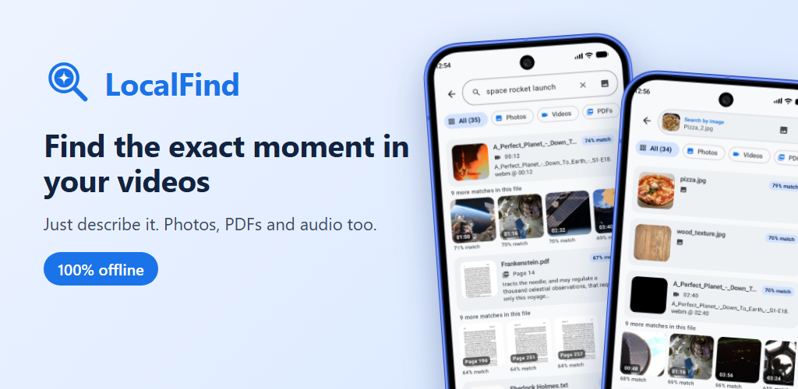
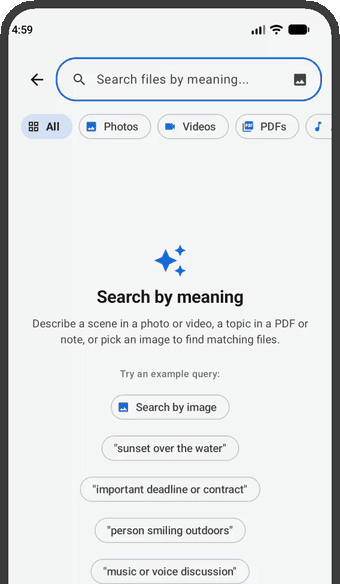
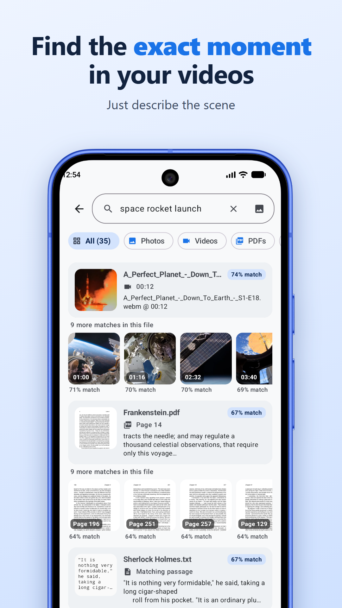
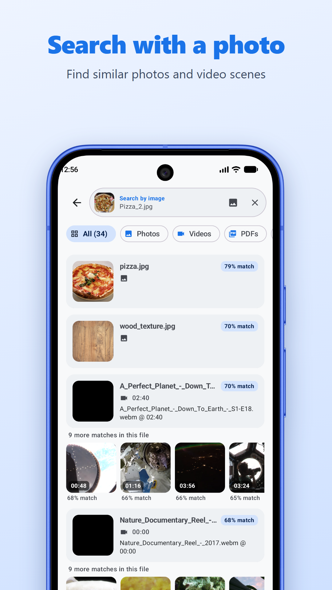
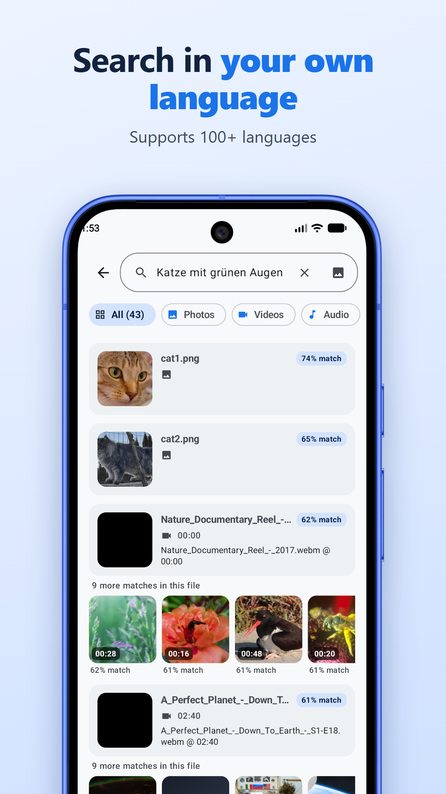
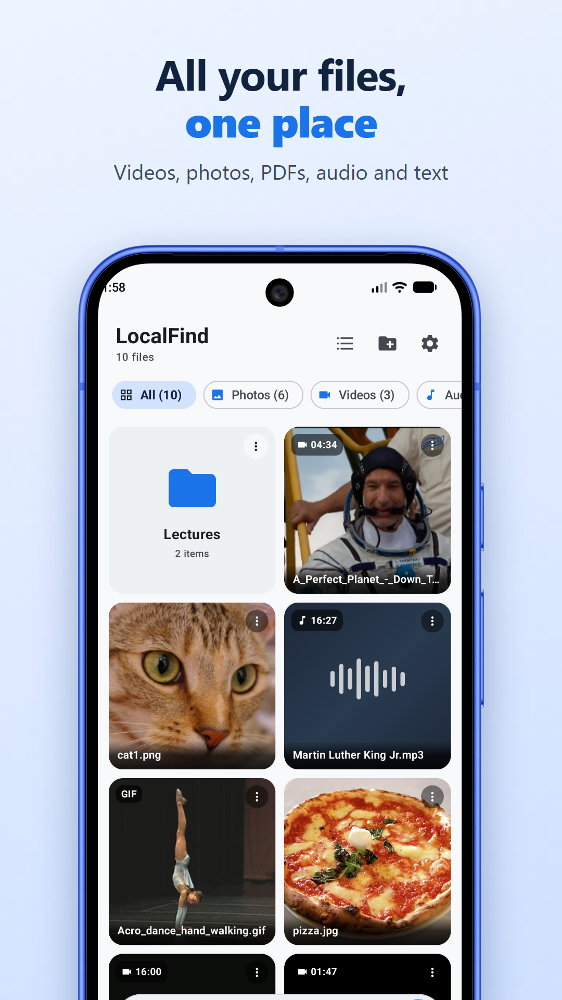

# LocalFind



[Website](https://bjdavey.github.io/localfind/) · [Privacy policy](https://bjdavey.github.io/localfind/privacy.html) · [Feedback](https://github.com/bjdavey/localfind/issues)


<!-- GIF floats left so the text sits beside it on desktop. The first line is a spacer image
     (360 px wide, 1 px high, translucent gray like GitHub's divider lines): images cannot wrap, so on a phone it does not fit beside the GIF and the text
     drops underneath it. GitHub strips CSS, so this is the only way to get "side by side on web, stacked on mobile". -->



**Search inside your files by meaning**

Describe what you remember, in your own language, to find videos, audio, PDFs, photos and notes. LocalFind opens the result at the matching moment, page or passage.

Edge AI that runs on your phone, accelerated by the NPU on supported chips, so your files stay private and the app works 100% offline.

Android app, coming soon to Google Play.

<br clear="all">

## Features

- **Search by meaning**: type a description in any of 100+ languages. Results show the file and the matching time or page, and open in the built-in viewer at that spot.
- **Search by image**: use a photo to find similar photos and matching video scenes.
- **Search inside a file**: scope a search to one document, video or audio file.
- **Library**: folders, multi-select, per-file progress, retry failed files, file details.
- **Background indexing**: pause, resume and cancel; survives the app being closed or killed.
- **Add files** with the system picker (files or whole folders) or share them from another app.
- **Light and dark themes**, plus advanced tuning in Settings (similarity threshold, hardware accelerator and more).

<p align="center">
  
  
  
  
</p>

### Supported files

| Type | Formats | Result opens at |
| :--- | :--- | :--- |
| Video | `.mp4`, `.mkv`, `.webm` | Matching time |
| Audio | `.mp3`, `.m4a`, `.wav` | Matching time |
| Image | `.jpg`, `.jpeg`, `.png`, `.gif` | The image |
| PDF | `.pdf` (text-based, no OCR) | Matching page |
| Text | `.txt`, `.md` | Matching passage |

## Privacy

- The app has **no `INTERNET` permission**, so it cannot connect to the internet at all.
- No account, no ads, no analytics, no crash reporting, no cloud services.
- Files are linked, not copied. The only exception is files shared from other apps, which are copied into app storage ([details](docs/ARCHITECTURE.md)). The search index stays on the device.
- See the [privacy policy](https://bjdavey.github.io/localfind/privacy.html).

## How it works

Every file is split into chunks (video windows, audio windows, PDF pages, text passages, whole images). One multimodal embedding model ([EmbeddingGemma 2](https://huggingface.co/litert-community/embeddinggemma-2-740m-litert-lm)) turns each chunk into a vector in a shared space, so a text query can match a video frame, an audio clip or a page. Vectors are stored in a local SQLite database and searched by cosine similarity. Inference runs on the phone's NPU, GPU or CPU.

Details: [docs/ARCHITECTURE.md](docs/ARCHITECTURE.md). Product scope: [docs/PRD.md](docs/PRD.md).

## Build and run

### Requirements

- Android Studio (or the Android SDK). Gradle downloads the matching JDK automatically.
- A device or emulator running Android 12 (API 31) or newer.
- The EmbeddingGemma 2 model (about 485 MB). Model files are not in this repository; the deploy script below downloads the right one from [Hugging Face](https://huggingface.co/litert-community/embeddinggemma-2-740m-litert-lm/tree/main) and pushes it to the device.

### Build

```powershell
cd android
.\gradlew test          # unit tests
.\gradlew assembleDebug # build the debug app
```

### Install

Use the deploy script for every target (emulator, phone with or without an NPU). It detects the device, builds the App Bundle, installs the right splits, downloads and pushes the model, and launches the app:

```powershell
cd android
.\deploy-bundle.ps1 -DeviceId <serial>   # or deploy-bundle.sh on macOS / Linux
```

Do not use plain `adb install` on NPU phones, it drops the NPU runtime split APKs.

Small royalty-free test files are in [samples/](samples/README.md).

### NPU support

NPU indexing is several times faster than CPU. Supported chips: Qualcomm Snapdragon 8 Gen 2, 8 Gen 3, 8 Elite and 8 Elite Gen 5; Google Tensor G5 and G6; MediaTek Dimensity 9400 and 9500 (not yet tested on a device). Other phones use the GPU or CPU. Test results: [docs/ARCHITECTURE.md](docs/ARCHITECTURE.md#3-model-delivery--chipset-support).

## Roadmap

Android is the first platform. Planned next (full list in the Backlog of [TODO.md](TODO.md)):

- iOS and desktop apps
- OCR for scanned PDFs
- Keyword search combined with meaning search, including file names
- More formats (WebP, HEIC, OGG, FLAC, MOV) and code files
- Rescan imported folders for new files, and export / backup of the index

## Contributing

Contributions are welcome. Please read [CONTRIBUTING.md](CONTRIBUTING.md) first. Security issues: see [SECURITY.md](SECURITY.md).

## License

LocalFind is licensed under the [Apache License 2.0](LICENSE).

### Third-party

- The EmbeddingGemma model is **not** covered by this license. It is distributed by Google under the [Gemma Terms of Use](https://ai.google.dev/gemma/terms). Model files are downloaded separately and are not part of this repository.
- Built with [MediaPipe Tasks](https://github.com/google-ai-edge/mediapipe), [LiteRT](https://github.com/google-ai-edge/LiteRT), [LiteRT-LM](https://github.com/google-ai-edge/LiteRT-LM), [AndroidX Media3](https://github.com/androidx/media), [Jetpack Compose](https://developer.android.com/compose), [Coil](https://github.com/coil-kt/coil) and [PdfBox-Android](https://github.com/TomRoush/PdfBox-Android), each under its own license.
- UI icons are [Google Material Symbols](https://fonts.google.com/icons) (Apache 2.0).
